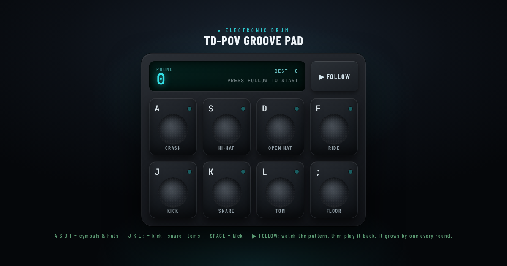

# TD-POV Groove Pad

> An 8-pad electronic drum kit with a built-in Simon-says memory game — watch the beat grow, then play it back.



🔗 **[Play Live →](https://umairjailani.github.io/Drum-on-keys/)**

---

## What It Does

- **8-pad drum kit** — Crash, Hi-Hat, Open Hat, Ride, Kick, Snare, Tom, Floor
- **Keyboard, mouse, and touch** — `A S D F` (top row) + `J K L ;` (bottom row), or just click/tap
- **All sound synthesized live** via the Web Audio API — no audio files to load, ever
- **Follow mode**: a Simon-says memory game. Press FOLLOW, watch a pattern (starts at 3 pads), repeat it back — correct rounds add one more pad, a wrong one ends the run
- **Musical, not random** — the generated sequences are weighted (kick/snare/hi-hat common, toms occasional, crash/ride rare) and never repeat a pad back-to-back, so it reads like an actual drum fill
- Best round tracked via `localStorage`

## Tech Stack

- HTML / CSS / Vanilla JavaScript — no framework, no build step
- Web Audio API for all percussion synthesis
- ~20KB total, loads instantly

## Run Locally

```bash
git clone https://github.com/UmairJailani/Drum-on-keys.git
cd Drum-on-keys
# open index.html in your browser, or use VS Code Live Server
```

---

## From Original to V2

This started as a basic course exercise — static pad images, pre-recorded `.mp3` hits, no game mode. It went through a couple of abandoned rebuild attempts (a 3D Three.js kit, then a raw exported design-tool bundle) before landing here.

| Original | V2 (this rebuild) |
|---|---|
| Static drum sounds (`.mp3` files) | Synthesized live via Web Audio — nothing to load |
| Static pad images | Pure CSS, glows and animates on hit |
| No game mode | Simon-says Follow mode, grows every round |
| Random-feeling nothing | Weighted, musical sequence generation |
| — | Best-round tracking via `localStorage` |

---

Made by [Umair Jailani](https://github.com/UmairJailani) · Built with [Claude Code](https://claude.ai/code)
